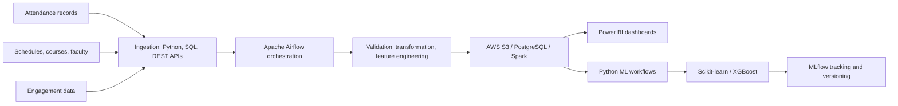

# University Student & Staff Attendance Intelligence Platform

**Role:** Data Engineer / Data Analytics Project  
**Timeline:** February 2026 – Present

## Project overview

An end-to-end data engineering and analytics project focused on preparing student and staff attendance information for operational reporting and machine-learning analysis. The workflow brings together attendance records, class schedules, course details, faculty information, and engagement data.

This page documents the project scope described in Shahina Shaik's resume. It is a project case study, not a claim that a public production application or runnable source-code package is available in this repository.

## Data workflow

1. **Ingestion:** Integrate attendance, schedule, course, faculty, and engagement data using Python, SQL, Apache Airflow, and REST APIs.
2. **Preparation:** Automate data ingestion, transformation, validation, and feature-engineering workflows to prepare reliable analytical datasets.
3. **Processing and storage:** Use AWS S3, PostgreSQL, and Apache Spark to prepare curated datasets for attendance trends, engagement analysis, class performance, and operational reporting.
4. **Business intelligence:** Build Power BI dashboards for daily and weekly attendance KPIs, attendance trends, engagement metrics, and faculty/class-level insights.
5. **Machine learning:** Use Python, Pandas, NumPy, Scikit-learn, and XGBoost to examine attendance patterns, predict attendance risks, and support early-intervention analysis.
6. **Tracking and reliability:** Use MLflow for model tracking and version management, with Airflow, Python, Docker, and Git supporting workflow monitoring and reproducibility.

## High-level workflow

*Conceptual workflow based on the project description in the resume.*

## Technology stack

| Area | Technologies |
|---|---|
| Programming and data | Python, SQL, Pandas, NumPy |
| Ingestion and orchestration | REST APIs, Apache Airflow |
| Processing and storage | Apache Spark, AWS S3, PostgreSQL |
| Analytics and reporting | Power BI |
| Machine learning | Scikit-learn, XGBoost |
| Reliability and model tracking | Docker, Git, MLflow |

## Project outcomes and use cases

- Curated datasets for attendance trends, student engagement, class performance, and operational reporting.
- Daily and weekly attendance KPIs with faculty- and class-level visibility.
- Attendance-pattern and risk analysis to support early-intervention decisions.
- Data-quality checks and automated workflow monitoring to improve pipeline reliability.
- Model tracking and version management through MLflow.

## Current public-repository scope

This repository currently contains the portfolio website and this written case study. It does **not** contain the attendance platform's runnable source code, production credentials, a public dataset, model metrics, or a live application demo. No model accuracy, deployment scale, or business-impact percentage is claimed here.

## Author

**Shahina Shaik**  
[GitHub profile](https://github.com/shahinashiny) · [LinkedIn](https://www.linkedin.com/in/shahina-shaik-8ba21a24a) · [Portfolio website](https://benevolent-wisp-556282.netlify.app/)